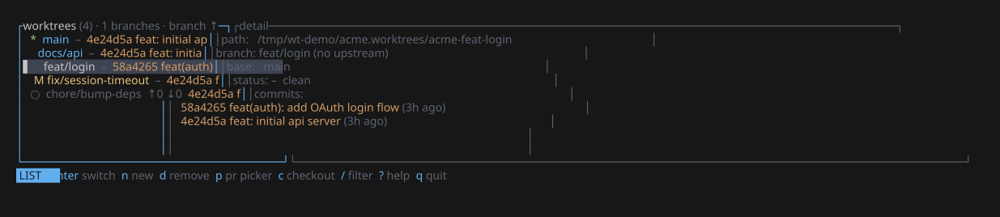

# wt

<p align="center">
  
</p>

`wt` is a CLI + TUI for Git worktrees and the GitHub pull requests on them: create
a branch and its worktree in one step, jump between worktrees, check a PR out into
its own directory, and clean up once the work merges. Git stays the source of
truth — worktrees made or removed with plain `git` show up too.

## Install

```bash
mise use -g github:getkono/wt   # mise: prebuilt binary from GitHub Releases
cargo install kono-wt           # cargo: build from crates.io (Rust via https://rustup.rs)
brew install getkono/tap/wt     # Homebrew
```

Needs `git` ≥ 2.20, plus an authenticated [`gh` CLI](https://cli.github.com) for
`wt pr` and `wt issue`; everything else works offline.

Then add the shell integration, which lets `wt` change your directory and gives
completions of real worktree, branch, and PR names:

```bash
eval "$(wt shell-init zsh)"     # ~/.zshrc (or bash in ~/.bashrc)
wt shell-init fish | source     # ~/.config/fish/config.fish
```

PowerShell and elvish are supported too (`wt shell-init --help`). Without it,
`wt` only prints the path to go to.

## Usage

Run `wt` in a repository to open the TUI, and press `?` for its keys.

```bash
wt new feat/login               # new branch + worktree, and cd into it
wt switch                       # fuzzy-pick a worktree to jump to
wt pr 42                        # check out PR #42 into its own worktree
wt issue 123                    # worktree for issue #123, with a proposed branch name
wt new feat/x --start claude    # set up the worktree, then run a command in it
wt list                         # every worktree, with dirty and ahead/behind state
wt drop                         # remove the worktree you're in, keep the branch
wt prune --all --dry-run        # preview cleaning up merged and stale work
```

`wt --help` lists everything. `remove`, `drop`, and `prune` won't delete
uncommitted or unpushed work without `--force`.

## Configuration

`wt config get|set|list|edit` manages a per-repo `.wt.toml` (or the global config,
with `--global`). For example:

```toml
path_template = "{repo_parent}/{repo}.worktrees/{repo}-{branch_slug}"  # the default
copy = [".env"]                       # ignored files to bring into new worktrees

[hooks]
post_create = "npm install"           # runs inside each new worktree
```

## As a library

The worktree engine is the [`kono-wt`](https://crates.io/crates/kono-wt) crate
(imported as `wt`); `default-features = false` drops the CLI and TUI. See the
[API docs](https://docs.rs/kono-wt).

## Development

Needs [rustup](https://rustup.rs) and [mise](https://mise.jdx.dev).

```bash
mise install          # dev tools and git hooks
mise run test
mise run lint         # Clippy, warnings as errors
mise run coverage     # 80% line-coverage floor
```

`mise tasks` lists the rest; `mise run svg` regenerates the screenshot above. Releases are cut by [release-plz](https://release-plz.dev);
see [RELEASING.md](RELEASING.md).

## License

MIT — see [LICENSE](LICENSE).
